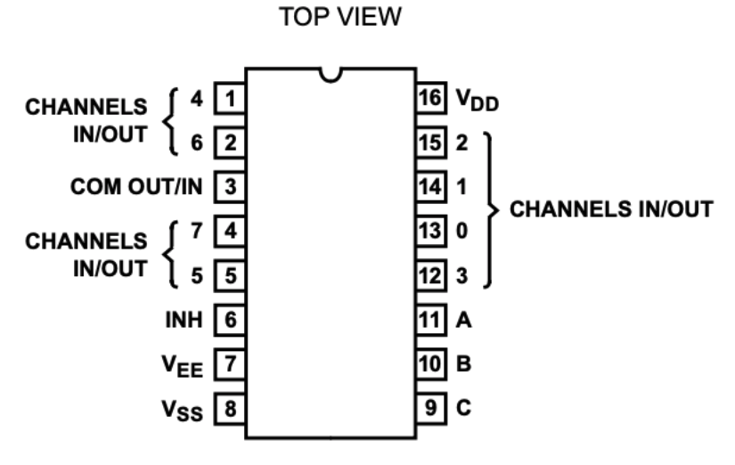

# 6am-6pm Sundial Pin Chart

This chart follows the active channel assignments in `sundial_test/pin_mapping.h`.

`Pin` is written as the CD4051 physical input pin followed by the selected channel.

| Time | Pin | My Wire Color | MUX |
| --- | --- | --- | --- |
| 6am | Pin 2 - X6 | Brown | 2 |
| 7am | Pin 14 - X1 | Orange | 2 |
| 8am | Pin 15 - X2 | Red | 2 |
| 9am | Pin 12 - X3 | Green | 1 |
| 10am | Pin 13 - X0 | Yellow | 1 |
| 11am | Pin 14 - X1 | Orange | 1 |
| 12pm | Pin 15 - X2 | Red | 1 |
| 1pm | Pin 1 - X4 | Purple | 1 |
| 2pm | Pin 2 - X6 | Brown | 1 |
| 3pm | Pin 4 - X7 | White | 1 |
| 4pm | Pin 5 - X5 | Blue | 1 |
| 5pm | Pin 1 - X4 | White | 2 |
| 6pm | Pin ? - X4 | White | 2 |